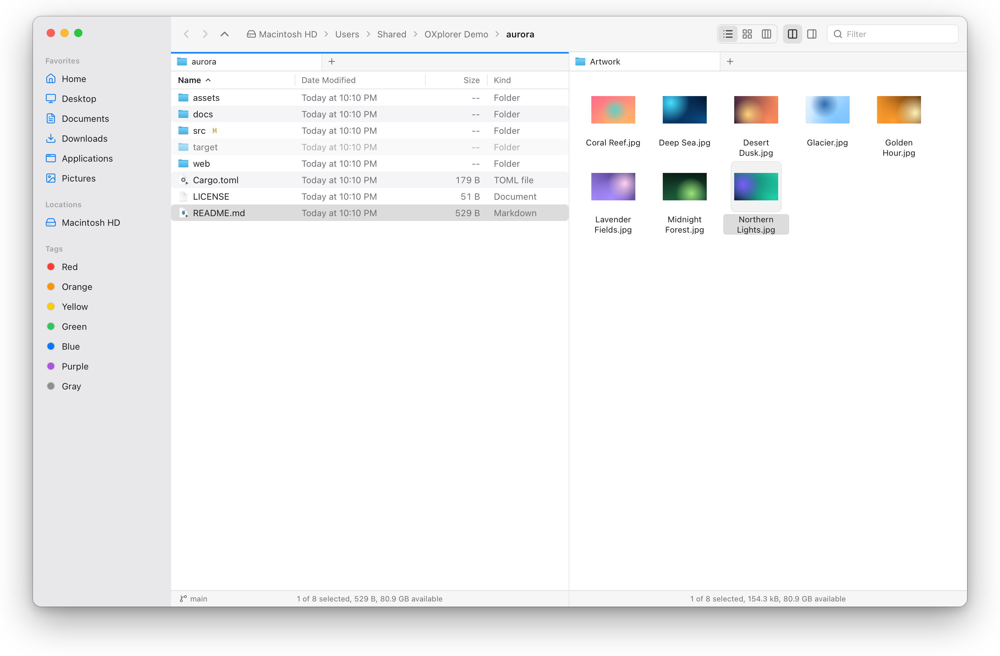
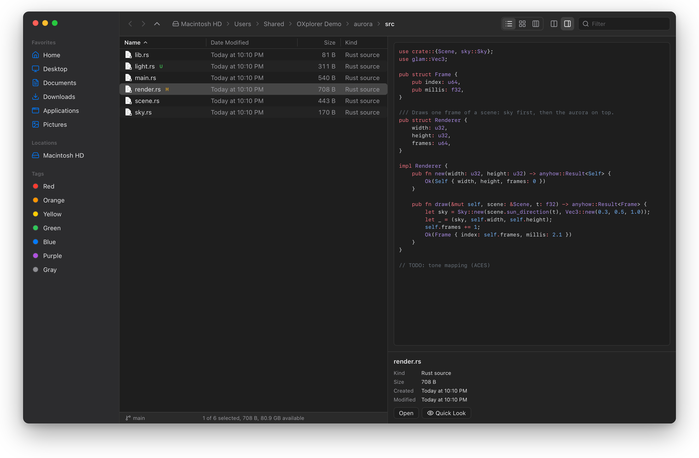
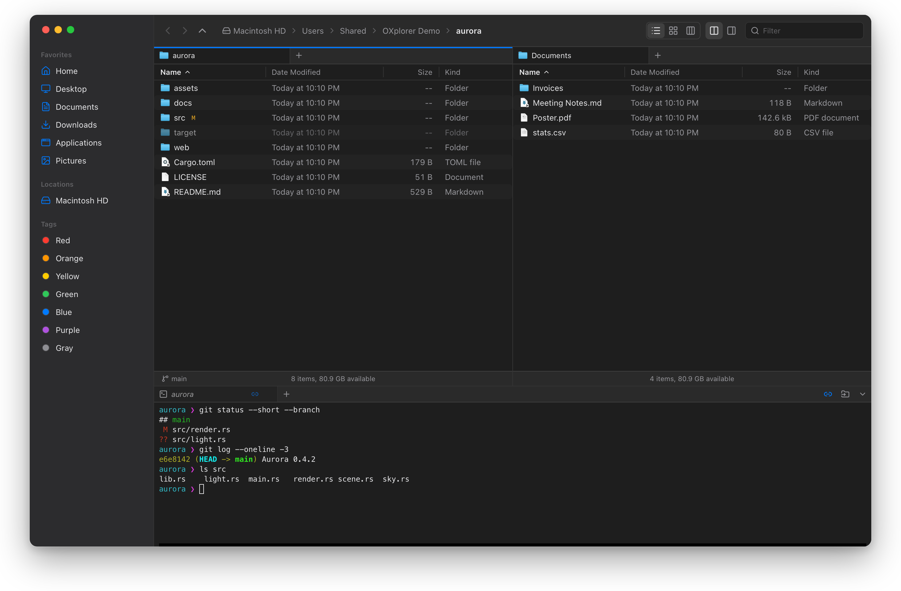
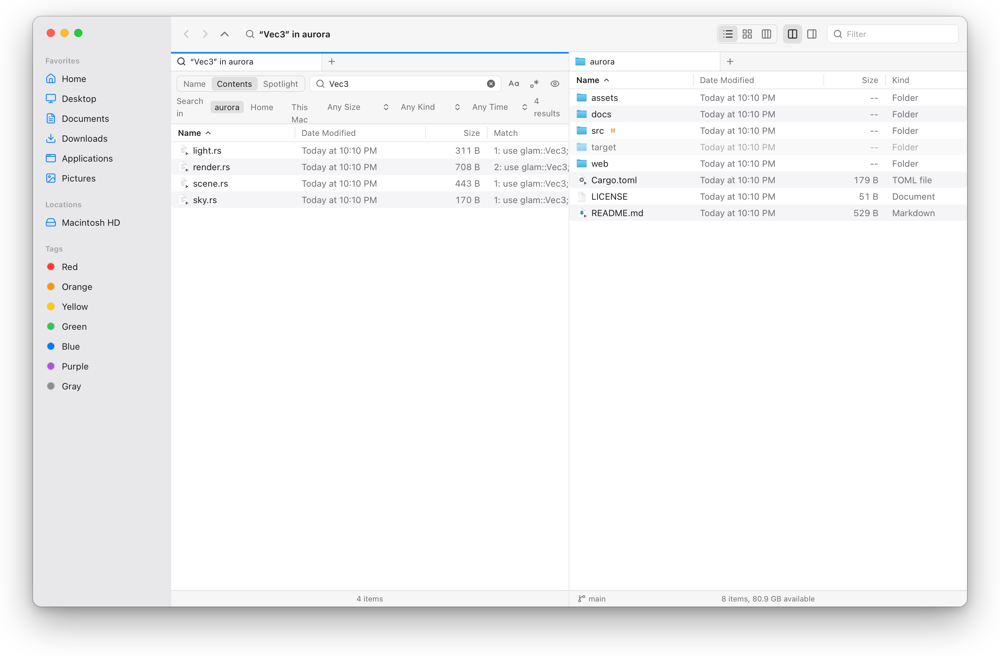
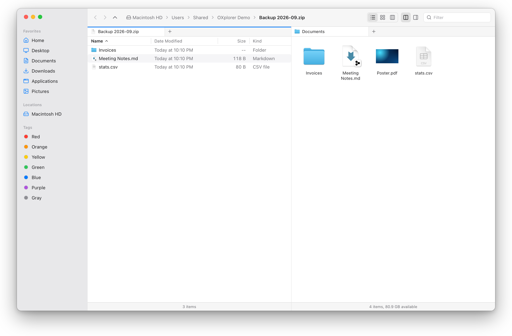
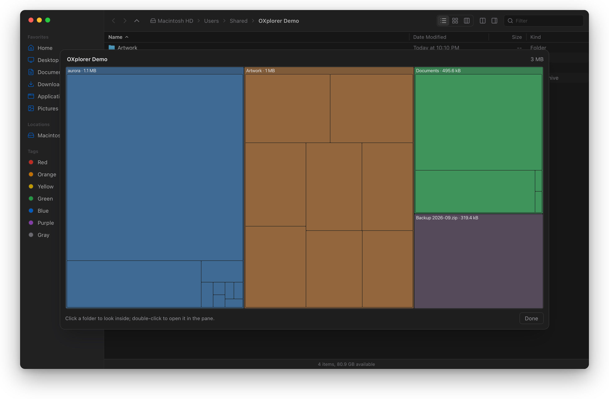
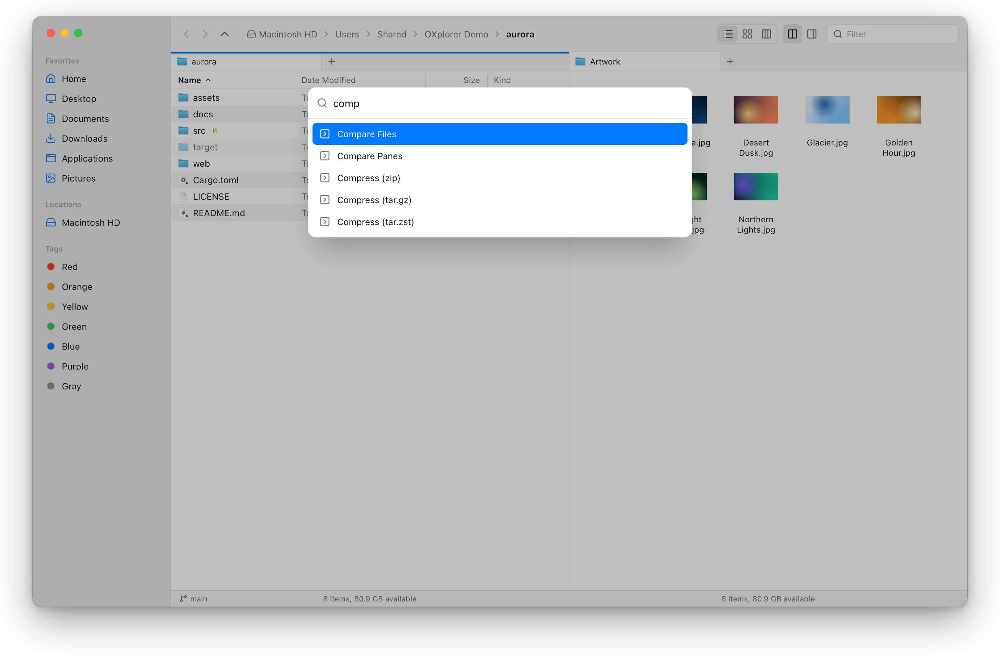

<div align="center">

# OXplorer

**A fast, dual-pane file manager for macOS.**
Finder's look and feel with Total Commander's efficiency: two panes, tabs, a built-in terminal, servers and archives as folders.

[](https://github.com/ersinkoc/oXplorer/releases)


[](#license)



</div>

## Why OXplorer

- **Two panes, many tabs.** Copy and move between panes with F5 / F6, compare them, keep each pane's tabs and come back to the same layout tomorrow.
- **Native.** System icons and thumbnails, the macOS menu bar, Quick Look, Finder tags, the shared clipboard and drag and drop with Finder, dark mode and your accent color.
- **Fast.** Folders stream in: 100,000 entries list in about a second, and the first rows appear in ~20 ms. Changes on disk show up within ~100 ms.
- **Keyboard-first.** Finder's shortcuts, type-ahead, ⌘K to run any command or jump to a folder, and every menu shortcut can be changed.
- **Everything in one window.** A terminal that follows the pane, previews, search, archives, servers, Git status and disk usage, all without leaving the window.

## Install

In Terminal (macOS 14 or later, Apple Silicon and Intel):

```bash
curl -fsSL https://raw.githubusercontent.com/ersinkoc/oXplorer/main/install.sh | sh
```

This installs the newest release, betas included, into `/Applications`; run it again to update. Set `OXPLORER_VERSION=0.1.0-beta.13` for a specific release, or `OXPLORER_DEST=~/Applications` to install without an administrator password. Apps downloaded with `curl` open without the "unidentified developer" prompt.

Or download the DMG from the [Releases page](https://github.com/ersinkoc/oXplorer/releases) and drag OXplorer to Applications. Betas aren't signed with an Apple Developer ID yet, so macOS blocks the first launch: right-click OXplorer → **Open** (or System Settings → Privacy & Security → **Open Anyway**). **Check for Updates…** tells you when a newer beta is out.

> **Status: public beta.** Everything in the [plan](oxplorer-project-plan-v2.md) is built. Signed, notarized releases that update themselves (and a Homebrew cask) come with v0.1.0; see [packaging/RELEASING.md](packaging/RELEASING.md).

## A tour

### Preview, Git and dark mode



The preview pane (⇧⌘P) shows images, video, audio, PDFs and documents, syntax-highlighted code and rendered Markdown. Space opens the native Quick Look panel. In a Git repository, changed, new and ignored files get badges and the status bar shows the branch.

### A terminal that follows you



Your login shell sits in a panel under the panes (⌃\`), with tabs. In Link mode the pane follows the shell's `cd`, and **Go to Folder in Terminal** does the opposite. Drop files on it to type their paths, quoted.

### Search names, contents or Spotlight



⌘F filters the current folder. ⇧⌘F searches file names, file contents (ripgrep's engine, `.gitignore`-aware) or Spotlight, with size, kind and date filters. Results open in a tab that works like a folder: preview, copy, rename or delete right there.

### Archives and servers are folders



Double-click a zip or tarball to browse it, then preview, open or copy out single items without extracting everything. Compress to zip (with a password if you like), tar.gz or tar.zst. SFTP, FTP(S), WebDAV and S3 connections live in the sidebar and work the same way: browse, upload, download, rename and delete. Passwords stay in your Keychain.

### Where did the space go?



**Disk Usage** (⌥⌘D) draws a zoomable treemap of everything under a folder. Click a block to look inside it; double-click to open it in the pane.

### Any command, from the keyboard



⌘K finds any command and your most used folders.

## All features

| | |
|---|---|
| **Panes and tabs** | Dual pane (⌘U), tabs per pane (pin, reorder, drag to the other pane), reopen closed tabs (⇧⌘T), synchronized browsing, session restore, New Window (⌘N) |
| **Views** | List, icon and column views (⌘1 / ⌘2 / ⌘3), columns of your choice, sort menu, folders on top, per-folder view memory, adjustable icon size |
| **File operations** | Copy, move, duplicate, trash and delete with progress, pause and cancel; APFS clones; Replace, Keep Both, Skip or Merge on conflicts; undo and redo (⌘Z / ⇧⌘Z) |
| **Finder interop** | Shared clipboard (⌘C / ⌘V, ⌥⌘V to move), drag and drop both ways, Open With, Finder tags, aliases, Get Info with permissions and Locked, an "Open in OXplorer" Finder extension |
| **Compare and sync** | Compare Panes (what's missing or newer on each side), Synchronize Folders, Compare Files (line diff), Find Duplicates |
| **Batch tools** | Batch Rename with live preview, Change Dates, Convert Image, Rotate, Split and Combine Files, checksum files and Verify Checksums |
| **Search** | Filter (⌘F), name, content and Spotlight search (⇧⌘F) with filters, Select Matching, tags in the sidebar |
| **Integrations** | Terminal panel, Git status, servers (SFTP, FTP(S), WebDAV, S3), archives as folders, disk usage treemap, Empty Trash |
| **Settings** | Appearance, language (English, Turkish), tabs, terminal and fully customizable menu shortcuts (⌘,) |

## Development

Requirements: macOS 14+, Xcode Command Line Tools, Rust (stable), Node 24 and pnpm.

```bash
pnpm install
pnpm tauri dev                     # restores your last session (home folder on first run)
pnpm tauri dev -- -- ~/Projects    # opens a specific folder in a new tab
pnpm check && pnpm check:rust      # lint, type-check, tests
scripts/screenshots.sh             # regenerates the screenshots above (needs Google Chrome)
```

Built with Tauri 2, React 19 and Rust. Architecture, decisions and the roadmap are in [oxplorer-project-plan-v2.md](oxplorer-project-plan-v2.md); contributor and agent rules are in [CLAUDE.md](CLAUDE.md). The original v1 plan is kept in [oxplorer-project-plan.md](oxplorer-project-plan.md).

## License

MIT © [OXOGNET OÜ](https://oxog.net)
